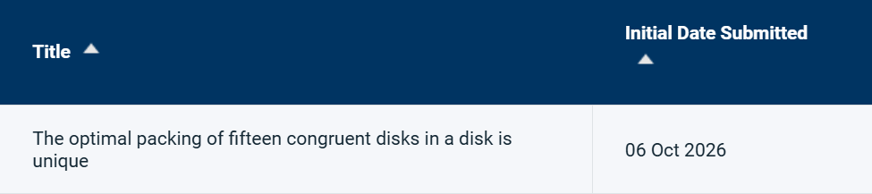

# 作者说明

[English](AUTHOR_NOTE.md)

2026 年 9 月，我开始独立研究十五个等圆在圆内的最优堆积问题。10 月 6 日，我将稿件 *The optimal packing of fifteen congruent disks in a disk is unique* 投给了 *Discrete & Computational Geometry*。10 月 15 日，我在 [Zenodo](https://doi.org/10.5281/zenodo.23319941) 公开了手稿及相关材料。

我是安徽理工大学 2024 级弹药工程与爆炸技术专业的本科生，并非数学专业的学生。能把自己感兴趣的几何问题研究到这一步，将最优性和全局唯一性的论证逐步落实为可以检查的证明，对我来说已经是一件非常值得高兴的事。

今天，我得知 nor 已于 10 月 11 日公开了[涵盖十五、十六、十七、十八和二十个等圆的工作](https://nor-blog.pages.dev/posts/2026-10-11-circle-in-circle-packing-15-20/)。看到同样热爱数学的人取得更广泛的进展，我为之高兴。不过，在完成自己的投稿之后，发现相近问题的结果已经先于我的预印本公开，我也确实感到了失落。我更看重探索和理解这个问题的过程，并不希望把这份仓库变成一场关于名分的争论。

受自己的英文表达能力以及当时处理 arXiv 投稿要求时遇到的困难影响，我没有更早公开预印本。这是这段研究经历中我需要学习的一课：完成证明之后，也要及时、清楚地把工作分享出来。

这份仓库使我仍然感到欣喜。它提供十五点问题的另一条证明路线，以及最优半径和全局构型唯一性的 Lean 形式化。几何定义、构型归约、有限证书的正确性、等号分析和全局唯一性被接入同一套证明。读者可以检查定理的陈述，也可以自行构建和核对它们的公理依赖。我在 2026 年 10 月 15 日查阅的 nor 发布包提供了 Python 和 C++ 精确算术验证材料，其中没有对应的 Lean 源码；两项工作的具体关系见[证明比较](PROOF_COMPARISON.zh-CN.md)。

我希望这些材料能对想了解这个问题、学习几何形式化或复现证明的人有所帮助。对我而言，能把自己的研究过程转化为别人可以阅读、检查和继续使用的工作，已经有意义。欢迎提出问题、指出错误，也欢迎改进这些材料。

Xiuzhi Yang  
2026 年 10 月 15 日

## 投稿记录

以下是作者提供的同一张投稿系统截图中的两个裁剪区域，保留区域内的文字未改动。账号信息、稿件编号和处理状态已通过裁剪去除。

本稿于 2026 年 10 月 6 日提交至 *Discrete & Computational Geometry*。
